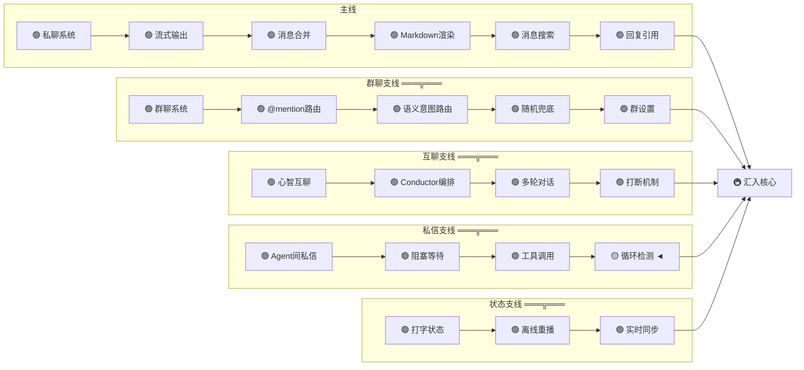
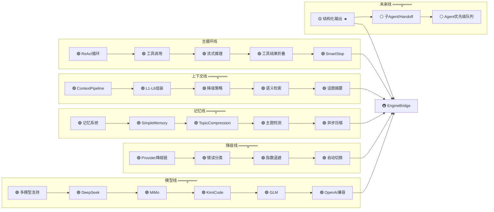
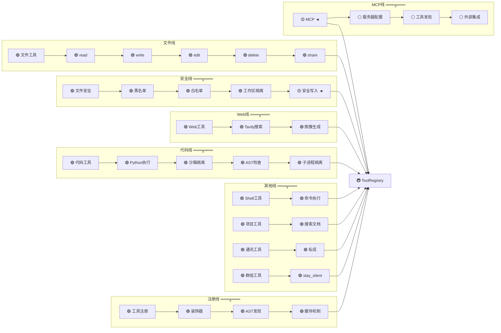
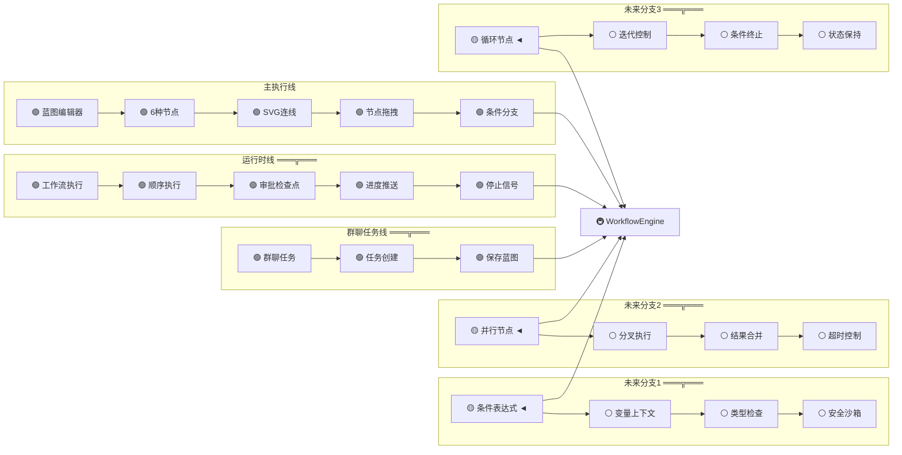
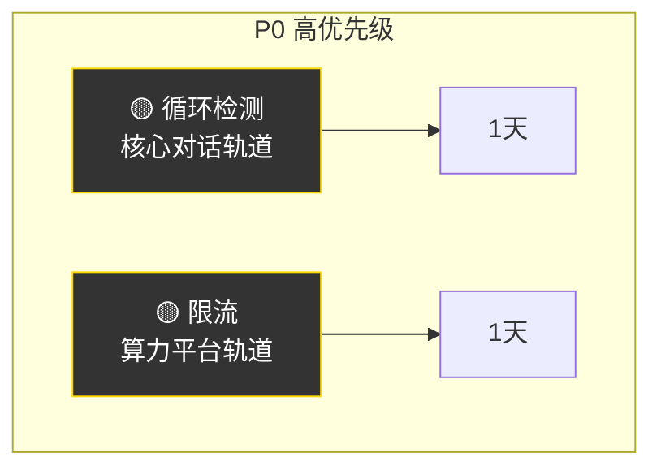
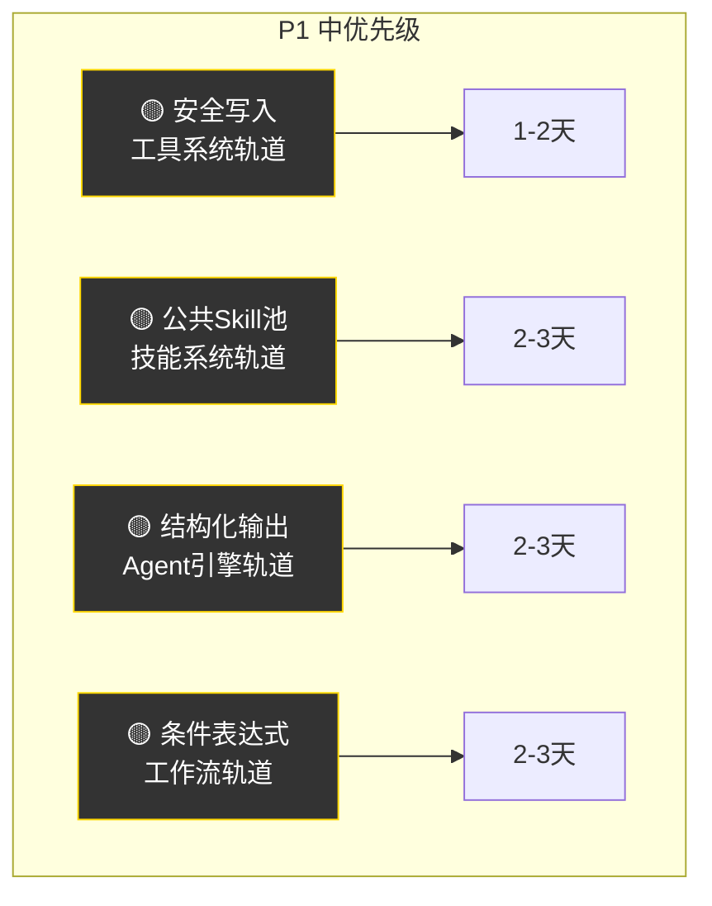
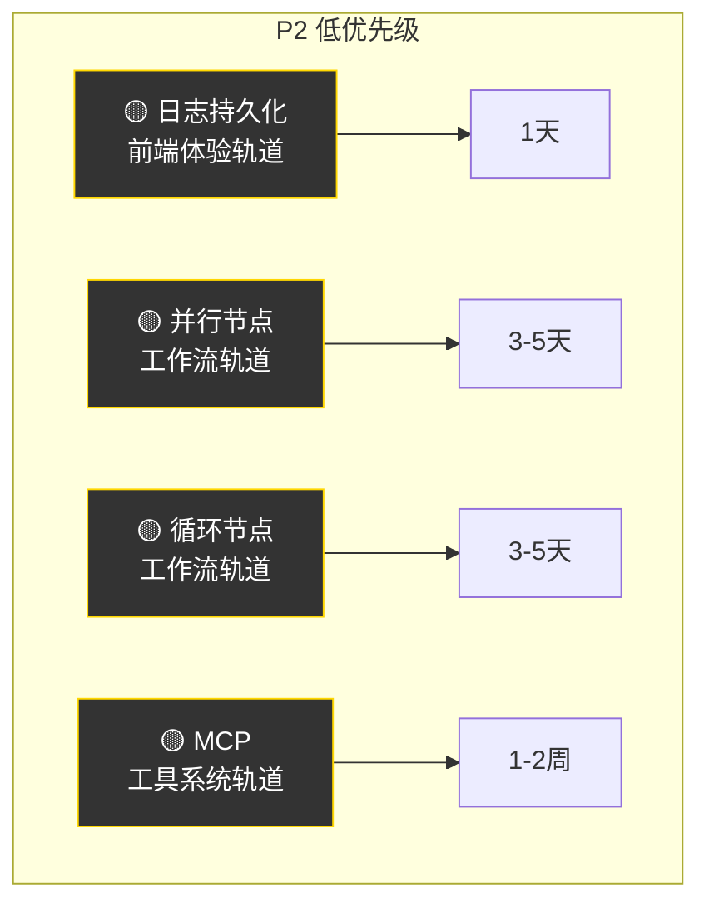
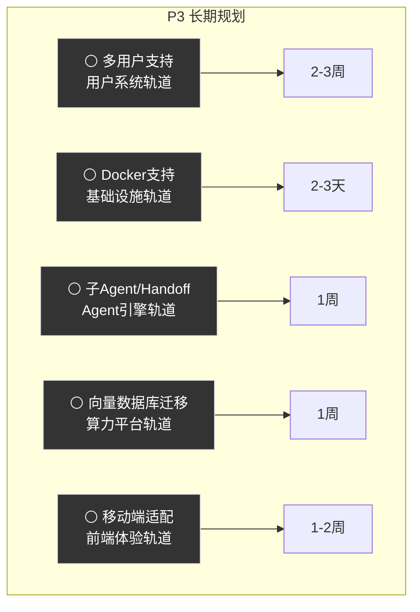
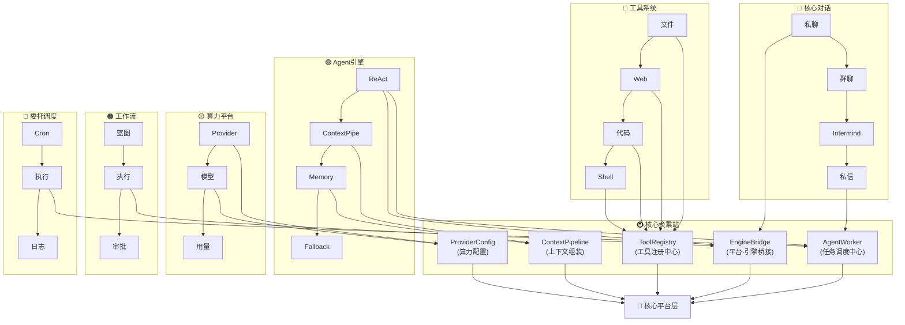

# CloudMind-Zome 路线图（Mermaid 地铁图式）

> 版本：1.0 | 日期：2026-06-22
> 使用 Mermaid 流程图模拟地铁图风格，支持轨道分叉、交汇、换乘

---

## 1. 系统总览地铁图

```mermaid
flowchart TB
    subgraph 时间轴["🕐 时间轴"]
        direction LR
        Q3["2026 Q3"] --- Q4["2026 Q4"] --- Q1["2027 Q1"]
    end

    subgraph 核心对话轨道["🔵 核心对话轨道"]
        direction LR
        A1["🟢 私聊系统"] --> A2["🟢 流式输出"] --> A3["🟢 消息合并"] --> A4["🟢 Markdown渲染"] --> A5["🟢 消息搜索"] --> A6["🟢 回复引用"]
        B1["🟢 群聊系统"] --> B2["🟢 @mention路由"] --> B3["🟢 语义意图路由"] --> B4["🟢 随机兜底"] --> B5["🟢 群设置"]
        C1["🟢 心智互聊"] --> C2["🟢 Conductor编排"] --> C3["🟢 多轮对话"] --> C4["🟢 打断机制"]
        D1["🟢 Agent间私信"] --> D2["🟢 阻塞等待"] --> D3["🟢 工具调用"] --> D4["🟡 循环检测 ◄"]
        E1["🟢 打字状态"] --> E2["🟢 离线重播"] --> E3["🟢 实时同步"]
    end

    subgraph Agent引擎轨道["🟢 Agent引擎轨道"]
        direction LR
        F1["🟢 ReAct循环"] --> F2["🟢 工具调用"] --> F3["🟢 流式推理"] --> F4["🟢 SmartStop"]
        G1["🟢 ContextPipeline"] --> G2["🟢 L1-L6组装"] --> G3["🟢 降级策略"] --> G4["🟢 语义检索"] --> G5["🟢 话题摘要"]
        H1["🟢 记忆系统"] --> H2["🟢 SimpleMemory"] --> H3["🟢 TopicCompression"] --> H4["🟢 主题检测"] --> H5["🟢 异步压缩"]
        I1["🟢 Provider降级链"] --> I2["🟢 错误分类"] --> I3["🟢 指数退避"] --> I4["🟢 自动切换"]
        J1["🟢 多模型支持"] --> J2["🟢 DeepSeek"] --> J3["🟢 MiMo"] --> J4["🟢 KimiCode"] --> J5["🟢 GLM"] --> J6["🟢 OpenAI兼容"]
        K1["🟡 结构化输出 ◄"]
    end

    subgraph 算力平台轨道["🟡 算力平台轨道"]
        direction LR
        L1["🟢 Provider CRUD"] --> L2["🟢 模型管理"] --> L3["🟢 测试连接"] --> L4["🟢 自动发现"]
        M1["🟢 模型类型"] --> M2["🟢 LLM"] --> M3["🟢 Embedding"] --> M4["🟢 ImageGen"] --> M5["🟢 STT"]
        N1["🟢 Agent级配置"] --> N2["🟢 推理模型"] --> N3["🟢 嵌入模型"] --> N4["🟢 图像生成"] --> N5["🟢 Fallback链"]
        O1["🟢 API Key加密"] --> O2["🟢 Fernet加密"] --> O3["🟢 安全存储"]
        P1["🟢 用量统计"] --> P2["🟢 7日趋势"] --> P3["🟢 Canvas图表"]
        Q1["🟡 限流 ◄"]
    end

    subgraph 工具系统轨道["🔴 工具系统轨道"]
        direction LR
        R1["🟢 文件工具"] --> R2["🟢 read"] --> R3["🟢 write"] --> R4["🟢 edit"] --> R5["🟢 delete"] --> R6["🟢 share"]
        S1["🟢 文件安全"] --> S2["🟢 黑名单"] --> S3["🟢 白名单"] --> S4["🟢 工作区隔离"] --> S5["🟡 安全写入 ◄"]
        T1["🟢 Web工具"] --> T2["🟢 Tavily搜索"] --> T3["🟢 图像生成"]
        U1["🟢 代码工具"] --> U2["🟢 Python执行"] --> U3["🟢 沙箱隔离"] --> U4["🟢 AST检查"]
        V1["🟢 Shell工具"] --> V2["🟢 命令执行"]
        W1["🟢 项目工具"] --> W2["🟢 列出文档"] --> W3["🟢 搜索文档"]
        X1["🟢 通讯工具"] --> X2["🟢 私信"] --> X3["🟢 进度汇报"]
        Y1["🟢 群组工具"] --> Y2["🟢 stay_silent"]
        Z1["🟢 工具注册"] --> Z2["🟢 装饰器"] --> Z3["🟢 AST发现"] --> Z4["🟢 缓存机制"]
        AA1["🟡 MCP ◄"]
    end

    subgraph 技能系统轨道["🟣 技能系统轨道"]
        direction LR
        AB1["🟢 私有技能"] --> AB2["🟢 目录加载"] --> AB3["🟢 SKILL.md解析"] --> AB4["🟢 上传/删除"]
        AC1["🟡 公共Skill池 ◄"] --> AC2["⚪ pools/目录"] --> AC3["⚪ 回收站"] --> AC4["⚪ Fork机制"]
    end

    subgraph 工作流轨道["🟠 工作流轨道"]
        direction LR
        AD1["🟢 蓝图编辑器"] --> AD2["🟢 6种节点"] --> AD3["🟢 SVG连线"] --> AD4["🟢 节点拖拽"] --> AD5["🟢 条件分支"]
        AE1["🟢 工作流执行"] --> AE2["🟢 顺序执行"] --> AE3["🟢 审批检查点"] --> AE4["🟢 进度推送"] --> AE5["🟢 停止信号"]
        AF1["🟢 群聊任务"] --> AF2["🟢 任务创建"] --> AF3["🟢 保存蓝图"]
        AG1["🟡 条件表达式 ◄"]
        AH1["🟡 并行节点 ◄"]
        AI1["🟡 循环节点 ◄"]
    end

    subgraph 委托调度轨道["🩵 委托调度轨道"]
        direction LR
        AJ1["🟢 定时任务"] --> AJ2["🟢 Cron触发"] --> AJ3["🟢 Interval触发"] --> AJ4["🟢 手动触发"]
        AK1["🟢 任务执行"] --> AK2["🟢 队列调度"] --> AK3["🟢 AgentWorker"] --> AK4["🟢 执行日志"] --> AK5["🟢 通知推送"]
        AL1["🟢 任务管理"] --> AL2["🟢 启用/暂停"] --> AL3["🟢 删除"] --> AL4["🟢 日志查看"]
    end

    subgraph 用户系统轨道["🩷 用户系统轨道"]
        direction LR
        AM1["🟢 单用户模式"] --> AM2["🟢 硬编码ID"] --> AM3["🟢 无登录流程"] --> AM4["🟢 本地存储"]
        AN1["🟢 用户档案"] --> AN2["🟢 profile.md"] --> AN3["🟢 头像上传"] --> AN4["🟢 昵称修改"]
        AO1["🟢 心智侧写"] --> AO2["🟢 四Tab编辑器"] --> AO3["🟢 SOUL.md"] --> AO4["🟢 AGENT.md"] --> AO5["🟢 USER.md"] --> AO6["🟢 MEMORY.md"]
        AP1["🟢 性格分析"] --> AP2["🟢 Big-5评分"] --> AP3["🟢 自动分析"]
        AQ1["🟡 多用户支持 ◄"] --> AQ2["⚪ 注册"] --> AQ3["⚪ 登录"] --> AQ4["⚪ 用户隔离"]
    end

    subgraph 前端体验轨道["⚪ 前端体验轨道"]
        direction LR
        AR1["🟢 通讯中枢"] --> AR2["🟢 私聊/群聊"] --> AR3["🟢 会话列表"] --> AR4["🟢 未读红点"] --> AR5["🟢 置顶"]
        AS1["🟢 形象展示"] --> AS2["🟢 立绘"] --> AS3["🟢 Live2D"] --> AS4["🟢 3D VRM"]
        AT1["🟢 消息交互"] --> AT2["🟢 Markdown"] --> AT3["🟢 代码高亮"] --> AT4["🟢 图片预览"] --> AT5["🟢 @提及"]
        AU1["🟢 系统界面"] --> AU2["🟢 壁纸"] --> AU3["🟢 系统日志"] --> AU4["🟢 系统设置"] --> AU5["🟢 拖拽面板"]
        AV1["🟢 Tauri桌面"] --> AV2["🟢 Rust嵌入"] --> AV3["🟢 后端健康检查"]
        AW1["🟡 日志持久化 ◄"]
        AX1["⚪ 移动端适配"]
    end

    subgraph 基础设施轨道["⬛ 基础设施轨道"]
        direction LR
        AY1["🟢 数据存储"] --> AY2["🟢 SQLite"] --> AY3["🟢 ChromaDB"] --> AY4["🟢 文件系统"]
        AZ1["🟢 向量检索"] --> AZ2["🟢 zvec本地"] --> AZ3["🟢 语义搜索"] --> AZ4["🟢 时间衰减"]
        BA1["🟢 配置管理"] --> BA2["🟢 YAML"] --> BA3["🟢 DB+YAML双写"] --> BA4["🟢 环境变量"]
        BB1["🟢 安全"] --> BB2["🟢 路径安全"] --> BB3["🟢 代码沙箱"] --> BB4["🟢 API Key加密"]
        BC1["🟡 Docker支持 ◄"] --> BC2["⚪ Dockerfile"] --> BC3["⚪ 生产环境配置"]
    end

    %% 轨道交汇（换乘站）
    AgentWorker["🚇 AgentWorker\n(核心换乘站)"]
    EngineBridge["🚇 EngineBridge\n(平台-引擎换乘)"]
    ToolRegistry["🚇 ToolRegistry\n(工具注册中心)"]
    ContextPipeline["🚇 ContextPipeline\n(上下文组装站)"]
    ProviderConfig["🚇 ProviderConfig\n(算力配置站)"]

    %% 连接换乘站
    A6 --> AgentWorker
    B5 --> AgentWorker
    C4 --> AgentWorker
    D3 --> AgentWorker
    E3 --> AgentWorker

    F4 --> EngineBridge
    G5 --> EngineBridge
    H5 --> EngineBridge
    I4 --> EngineBridge
    J6 --> EngineBridge

    R6 --> ToolRegistry
    S4 --> ToolRegistry
    T3 --> ToolRegistry
    U4 --> ToolRegistry
    V2 --> ToolRegistry
    W3 --> ToolRegistry
    X3 --> ToolRegistry
    Y2 --> ToolRegistry

    G4 --> ContextPipeline
    H5 --> ContextPipeline
    AZ4 --> ContextPipeline

    N5 --> ProviderConfig
    O3 --> ProviderConfig
    P3 --> ProviderConfig

    %% 所有轨道汇入核心
    AgentWorker --> CorePlatform["🌟 核心平台层"]
    EngineBridge --> CorePlatform
    ToolRegistry --> CorePlatform
    ContextPipeline --> CorePlatform
    ProviderConfig --> CorePlatform
    AJ5 --> CorePlatform
    AK5 --> CorePlatform
    AL4 --> CorePlatform
    AM4 --> CorePlatform
    AN4 --> CorePlatform
    AO6 --> CorePlatform
    AP3 --> CorePlatform
    AR5 --> CorePlatform
    AS4 --> CorePlatform
    AT5 --> CorePlatform
    AU5 --> CorePlatform
    AV3 --> CorePlatform
    AY4 --> CorePlatform
    AZ4 --> CorePlatform
    BA4 --> CorePlatform
    BB4 --> CorePlatform
```

---

## 2. 核心对话轨道详图

---

## 3. Agent引擎轨道详图

---

## 4. 工具系统轨道详图（含分叉）

---

## 5. 工作流轨道详图（多分叉）

---

## 6. 当前开发优先级（按轨道排序）

### P0 - 高优先级（本月）

### P1 - 中优先级（下月）

### P2 - 低优先级（季度）

### P3 - 长期规划（明年）

---

## 7. 轨道换乘关系图

---

## 图例

| 符号 | 含义 |
|------|------|
| 🟢 | 已实现站点 |
| 🟡 | 下一站 / 当前开发方向 |
| ⚪ | 规划中 / 未实现 |
| 🚇 | 换乘站（跨轨道协作点） |
| 🌟 | 核心平台层（所有轨道交汇） |
| ═══╦═══ | 轨道分叉点 |
| --> | 站点顺序连接 |

---

## 维护规则

1. **新增站点** → 在对应轨道添加 🟢 节点
2. **功能推进** → 🟡 节点变为 🟢，新节点标记 🟡
3. **轨道分叉** → 使用 subgraph 创建支线，用 ═══╦═══ 标注
4. **轨道合并** → 多个支线汇入同一换乘站
5. **本文档与代码同步**，每次 PR 涉及功能状态变更时更新
